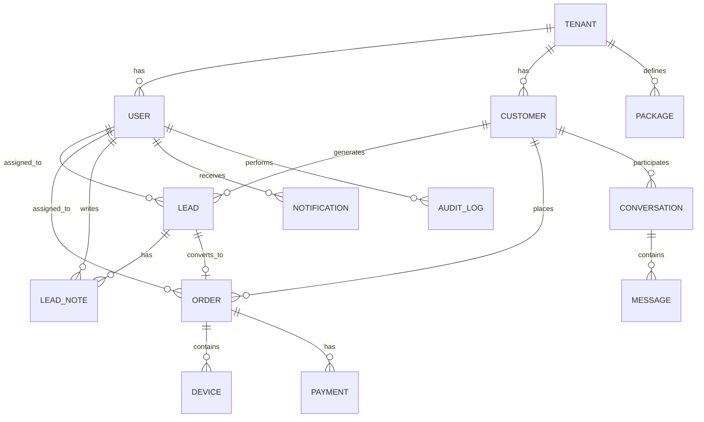

# orca CRM — خطة بناء الباكند الكاملة (NestJS + MySQL)

---

## الرؤية العامة

بناء باكند متكامل لنظام orca CRM باستخدام **NestJS 11** و **MySQL 8** كنظام قاعدة بيانات رئيسي.
الباكند يخدم واجهة Angular أمامية موجودة حالياً تعمل ببيانات ثابتة (mock data)، والهدف هو استبدال كل البيانات الوهمية بـ REST API حقيقي.

النظام مصمم ليكون **Multi-Tenant** من اليوم الأول — كل بيانات كل مستأجر (شركة IPTV) معزولة بحقل `tenant_id` على مستوى كل جدول.

---

## مراحل التنفيذ

### المرحلة 1: التأسيس والبنية التحتية (Foundation)

> **الملفات:** مشروع NestJS جديد + TypeORM + MySQL + Auth Module

| المهمة | الوصف |
|--------|-------|
| **1.1** إنشاء مشروع NestJS | `npx @nestjs/cli new` مع strict mode و ESLint |
| **1.2** إعداد TypeORM + MySQL | تهيئة `TypeOrmModule.forRootAsync()` مع `.env` |
| **1.3** وحدة Tenants | جدول `tenants` + entity + CRUD + seed أولي |
| **1.4** وحدة Auth | JWT authentication (access + refresh tokens) |
| **1.5** وحدة Users | جدول `users` مع RBAC (4 أدوار) + CRUD |
| **1.6** Tenant Interceptor | حقن `tenant_id` تلقائياً في كل طلب من JWT |
| **1.7** Global Guards & Pipes | `JwtAuthGuard` + `RolesGuard` + `ValidationPipe` |
| **1.8** Swagger Documentation | إعداد `@nestjs/swagger` مع كل endpoint |
| **1.9** Database Seeder | بيانات تجريبية أولية للمستأجر + المستخدمين |

**نتيجة المرحلة:** القدرة على تسجيل الدخول والحصول على JWT token مع tenant context.

---

### المرحلة 2: الوحدات الأساسية (Core Business Modules)

> **الملفات:** Leads + Orders + Devices + Subscriptions + Payments

| المهمة | الوصف |
|--------|-------|
| **2.1** وحدة Leads | CRUD + تغيير المراحل (Kanban) + Timeline Notes + ربط بالموظف المسؤول |
| **2.2** وحدة Customers | بيانات العميل الأساسية (الاسم، الهاتف، العنوان، الموقع الجغرافي) |
| **2.3** وحدة Packages | تعريف الباقات والأسعار والمدد |
| **2.4** وحدة Orders | إنشاء طلب (Wizard flow) + ربط بالعميل والباقة والأجهزة |
| **2.5** وحدة Devices | تسجيل الأجهزة (MAC, Device Key, App, Username) + حالة الجهاز |
| **2.6** وحدة Subscriptions | فترة الاشتراك + حالة (نشط / ينتهي قريباً / منتهي) + التجديد التلقائي |
| **2.7** وحدة Payments | سجل المدفوعات والفواتير لكل طلب |

**نتيجة المرحلة:** واجهات API كاملة لكل عمليات الأعمال الأساسية.

---

### المرحلة 3: الوحدات المساندة (Supporting Modules)

> **الملفات:** Notifications + Inbox/Messages + Performance + Audit Log

| المهمة | الوصف |
|--------|-------|
| **3.1** وحدة Notifications | إنشاء وتخزين الإشعارات حسب النوع + قراءة/عدم قراءة |
| **3.2** وحدة Conversations | محادثات موحدة (WhatsApp / SMS / RingCentral) + رسائل |
| **3.3** وحدة Performance | حساب KPIs للموظفين (نسبة التحويل، الإيرادات، عدد الطلبات) |
| **3.4** وحدة Audit Log | تسجيل كل العمليات الحساسة تلقائياً (من فعل ماذا ومتى) |
| **3.5** وحدة Dashboard | Aggregation endpoints لـ KPI cards + funnel + timeline |

**نتيجة المرحلة:** جميع شاشات CRM لديها API جاهز.

---

### المرحلة 4: الجودة والإنتاج (Quality & Production Readiness)

| المهمة | الوصف |
|--------|-------|
| **4.1** Unit Tests | اختبارات لكل service (Jest) |
| **4.2** E2E Tests | اختبارات تكامل للـ API endpoints |
| **4.3** Rate Limiting | `@nestjs/throttler` لحماية الـ API |
| **4.4** Logging | `winston` أو `pino` مع structured logging |
| **4.5** Health Checks | `@nestjs/terminus` لمراقبة DB + API health |
| **4.6** Docker | `Dockerfile` + `docker-compose.yml` (NestJS + MySQL + Redis) |
| **4.7** CI/CD Pipeline | GitHub Actions أو ما يناسب |

---

## هيكلة قاعدة البيانات (Database Schema)

### الجداول الأساسية

```
┌─────────────────────────────────────────────────┐
│                   tenants                        │
├─────────────────────────────────────────────────┤
│ id              UUID PK                          │
│ name            VARCHAR(255)     -- اسم الشركة   │
│ slug            VARCHAR(100) UQ  -- orca, etc     │
│ email           VARCHAR(255)                      │
│ currency        VARCHAR(10) DEFAULT 'USD'         │
│ timezone        VARCHAR(50) DEFAULT 'US/Eastern'  │
│ logo_url        VARCHAR(500) NULL                 │
│ is_active       BOOLEAN DEFAULT true              │
│ created_at      TIMESTAMP                         │
│ updated_at      TIMESTAMP                         │
└─────────────────────────────────────────────────┘

┌─────────────────────────────────────────────────┐
│                    users                         │
├─────────────────────────────────────────────────┤
│ id              UUID PK                          │
│ tenant_id       UUID FK → tenants.id             │
│ name            VARCHAR(255)                      │
│ email           VARCHAR(255) UQ per tenant        │
│ password_hash   VARCHAR(255)                      │
│ phone           VARCHAR(50) NULL                  │
│ role            ENUM('admin','sales_supervisor',  │
│                      'sales_rep','tech_support')  │
│ is_active       BOOLEAN DEFAULT true              │
│ is_online       BOOLEAN DEFAULT false             │
│ last_seen_at    TIMESTAMP NULL                    │
│ refresh_token   VARCHAR(500) NULL                 │
│ created_at      TIMESTAMP                         │
│ updated_at      TIMESTAMP                         │
│ INDEX (tenant_id)                                 │
│ UNIQUE (tenant_id, email)                         │
└─────────────────────────────────────────────────┘

┌─────────────────────────────────────────────────┐
│                  customers                       │
├─────────────────────────────────────────────────┤
│ id              UUID PK                          │
│ tenant_id       UUID FK → tenants.id             │
│ name            VARCHAR(255)                      │
│ phone           VARCHAR(50)                       │
│ email           VARCHAR(255) NULL                 │
│ city            VARCHAR(100)                      │
│ state           VARCHAR(50)                       │
│ address         VARCHAR(500) NULL                 │
│ lat             DECIMAL(10,7) NULL                │
│ lng             DECIMAL(10,7) NULL                │
│ source          VARCHAR(100) NULL                 │
│ created_at      TIMESTAMP                         │
│ updated_at      TIMESTAMP                         │
│ INDEX (tenant_id)                                 │
│ INDEX (tenant_id, phone)                          │
└─────────────────────────────────────────────────┘

┌─────────────────────────────────────────────────┐
│                    leads                         │
├─────────────────────────────────────────────────┤
│ id              UUID PK                          │
│ tenant_id       UUID FK → tenants.id             │
│ customer_id     UUID FK → customers.id           │
│ assigned_to     UUID FK → users.id               │
│ stage           ENUM('new','interested',          │
│                      'negotiation','converted',   │
│                      'closed')                    │
│ source          VARCHAR(100) NULL                 │
│ priority        ENUM('low','medium','high','urgent')│
│ follow_up_at    TIMESTAMP NULL                    │
│ estimated_value DECIMAL(10,2) NULL                │
│ close_reason    VARCHAR(500) NULL                 │
│ created_at      TIMESTAMP                         │
│ updated_at      TIMESTAMP                         │
│ INDEX (tenant_id)                                 │
│ INDEX (tenant_id, stage)                          │
│ INDEX (tenant_id, assigned_to)                    │
└─────────────────────────────────────────────────┘

┌─────────────────────────────────────────────────┐
│                 lead_notes                       │
├─────────────────────────────────────────────────┤
│ id              UUID PK                          │
│ tenant_id       UUID FK → tenants.id             │
│ lead_id         UUID FK → leads.id               │
│ author_id       UUID FK → users.id               │
│ type            ENUM('call','whatsapp',            │
│                      'status_change','general')    │
│ content         TEXT                              │
│ created_at      TIMESTAMP                         │
│ INDEX (tenant_id, lead_id)                        │
└─────────────────────────────────────────────────┘

┌─────────────────────────────────────────────────┐
│                  packages                        │
├─────────────────────────────────────────────────┤
│ id              UUID PK                          │
│ tenant_id       UUID FK → tenants.id             │
│ name            VARCHAR(255)                      │
│ duration_months INT                               │
│ price           DECIMAL(10,2)                     │
│ max_devices     INT DEFAULT 1                     │
│ description     TEXT NULL                         │
│ is_active       BOOLEAN DEFAULT true              │
│ created_at      TIMESTAMP                         │
│ updated_at      TIMESTAMP                         │
│ INDEX (tenant_id)                                 │
└─────────────────────────────────────────────────┘

┌─────────────────────────────────────────────────┐
│                   orders                         │
├─────────────────────────────────────────────────┤
│ id              UUID PK                          │
│ tenant_id       UUID FK → tenants.id             │
│ order_number    VARCHAR(20) UQ per tenant         │
│ customer_id     UUID FK → customers.id           │
│ lead_id         UUID FK → leads.id NULL          │
│ package_id      UUID FK → packages.id            │
│ assigned_to     UUID FK → users.id               │
│ status          ENUM('active','expiring',         │
│                      'expired','cancelled')       │
│ server_name     VARCHAR(255) NULL                 │
│ starts_at       TIMESTAMP                         │
│ expires_at      TIMESTAMP                         │
│ total_price     DECIMAL(10,2)                     │
│ payment_method  VARCHAR(100) NULL                 │
│ notes           TEXT NULL                         │
│ created_at      TIMESTAMP                         │
│ updated_at      TIMESTAMP                         │
│ INDEX (tenant_id)                                 │
│ INDEX (tenant_id, status)                         │
│ INDEX (tenant_id, customer_id)                    │
│ UNIQUE (tenant_id, order_number)                  │
└─────────────────────────────────────────────────┘

┌─────────────────────────────────────────────────┐
│                   devices                        │
├─────────────────────────────────────────────────┤
│ id              UUID PK                          │
│ tenant_id       UUID FK → tenants.id             │
│ order_id        UUID FK → orders.id              │
│ customer_id     UUID FK → customers.id           │
│ name            VARCHAR(255)                      │
│ device_type     ENUM('smart_tv','android_box',    │
│                      'mobile','pc','firestick',   │
│                      'apple_tv','mag')            │
│ device_type_name VARCHAR(255) NULL                │
│ mac_address     VARCHAR(17) -- SENSITIVE           │
│ device_key      VARCHAR(50) -- SENSITIVE           │
│ username        VARCHAR(100) -- SENSITIVE          │
│ app_name        VARCHAR(100) NULL                 │
│ quality_tag     VARCHAR(50) NULL                  │
│ status          ENUM('active','pending','expired',│
│                      'suspended')                 │
│ created_at      TIMESTAMP                         │
│ updated_at      TIMESTAMP                         │
│ INDEX (tenant_id)                                 │
│ INDEX (tenant_id, order_id)                       │
│ INDEX (tenant_id, mac_address)                    │
└─────────────────────────────────────────────────┘

┌─────────────────────────────────────────────────┐
│                  payments                        │
├─────────────────────────────────────────────────┤
│ id              UUID PK                          │
│ tenant_id       UUID FK → tenants.id             │
│ order_id        UUID FK → orders.id              │
│ invoice_number  VARCHAR(20) UQ per tenant         │
│ amount          DECIMAL(10,2)                     │
│ status          ENUM('paid','pending','refunded', │
│                      'failed')                    │
│ payment_method  VARCHAR(100)                      │
│ payment_date    TIMESTAMP                         │
│ notes           TEXT NULL                         │
│ created_at      TIMESTAMP                         │
│ INDEX (tenant_id)                                 │
│ INDEX (tenant_id, order_id)                       │
│ UNIQUE (tenant_id, invoice_number)                │
└─────────────────────────────────────────────────┘

┌─────────────────────────────────────────────────┐
│               notifications                      │
├─────────────────────────────────────────────────┤
│ id              UUID PK                          │
│ tenant_id       UUID FK → tenants.id             │
│ user_id         UUID FK → users.id               │
│ title           VARCHAR(500)                      │
│ description     TEXT NULL                         │
│ category        ENUM('followup','expiry',         │
│                      'messages','tasks','system')  │
│ status          ENUM('read','unread')              │
│ is_important    BOOLEAN DEFAULT false              │
│ reference_type  VARCHAR(50) NULL                  │
│ reference_id    UUID NULL                         │
│ created_at      TIMESTAMP                         │
│ INDEX (tenant_id, user_id)                        │
│ INDEX (tenant_id, user_id, status)                │
└─────────────────────────────────────────────────┘

┌─────────────────────────────────────────────────┐
│               conversations                      │
├─────────────────────────────────────────────────┤
│ id              UUID PK                          │
│ tenant_id       UUID FK → tenants.id             │
│ customer_id     UUID FK → customers.id           │
│ assigned_to     UUID FK → users.id NULL          │
│ channel         ENUM('whatsapp','sms',            │
│                      'ringcentral')               │
│ status          ENUM('unread','needs-reply',      │
│                      'completed','archived')       │
│ category        ENUM('renewal','audio-issue',     │
│                      'payment-confirm',            │
│                      'hardware-setup','general')   │
│ last_message_at TIMESTAMP NULL                    │
│ created_at      TIMESTAMP                         │
│ updated_at      TIMESTAMP                         │
│ INDEX (tenant_id)                                 │
│ INDEX (tenant_id, assigned_to)                    │
│ INDEX (tenant_id, status)                         │
└─────────────────────────────────────────────────┘

┌─────────────────────────────────────────────────┐
│                  messages                         │
├─────────────────────────────────────────────────┤
│ id              UUID PK                          │
│ tenant_id       UUID FK → tenants.id             │
│ conversation_id UUID FK → conversations.id       │
│ sender_id       UUID FK → users.id NULL          │
│ content         TEXT                              │
│ direction       ENUM('incoming','outgoing')       │
│ channel         ENUM('whatsapp','sms',            │
│                      'ringcentral')               │
│ delivery_status ENUM('sending','sent','delivered',│
│                      'read','failed')             │
│ created_at      TIMESTAMP                         │
│ INDEX (tenant_id, conversation_id)                │
└─────────────────────────────────────────────────┘

┌─────────────────────────────────────────────────┐
│                audit_logs                        │
├─────────────────────────────────────────────────┤
│ id              UUID PK                          │
│ tenant_id       UUID FK → tenants.id             │
│ user_id         UUID FK → users.id               │
│ action          VARCHAR(100)                      │
│ entity_type     VARCHAR(50)                       │
│ entity_id       UUID NULL                         │
│ old_values      JSON NULL                         │
│ new_values      JSON NULL                         │
│ ip_address      VARCHAR(45) NULL                  │
│ user_agent      VARCHAR(500) NULL                 │
│ created_at      TIMESTAMP                         │
│ INDEX (tenant_id)                                 │
│ INDEX (tenant_id, entity_type, entity_id)         │
│ INDEX (tenant_id, user_id)                        │
└─────────────────────────────────────────────────┘

┌─────────────────────────────────────────────────┐
│            role_permissions                      │
├─────────────────────────────────────────────────┤
│ id              UUID PK                          │
│ tenant_id       UUID FK → tenants.id             │
│ role            ENUM('admin','sales_supervisor',  │
│                      'sales_rep','tech_support')  │
│ permission_key  VARCHAR(100)                      │
│ is_allowed      BOOLEAN DEFAULT false             │
│ UNIQUE (tenant_id, role, permission_key)          │
└─────────────────────────────────────────────────┘
```

### العلاقات الرئيسية (ERD Summary)



---

## هيكل مجلدات الباكند

```
f:\apps\orca\nestjs\
├── src/
│   ├── main.ts
│   ├── app.module.ts
│   ├── common/                    # Shared utilities
│   │   ├── decorators/            # @CurrentUser, @TenantId, @Roles
│   │   ├── guards/                # JwtAuthGuard, RolesGuard, TenantGuard
│   │   ├── interceptors/          # TenantInterceptor, AuditInterceptor
│   │   ├── filters/               # HttpExceptionFilter
│   │   ├── pipes/                 # ParseUUIDPipe extensions
│   │   ├── dto/                   # PaginationDto, SortDto
│   │   └── interfaces/            # JwtPayload, TenantContext
│   ├── config/                    # Configuration (database, jwt, app)
│   │   ├── database.config.ts
│   │   ├── jwt.config.ts
│   │   └── app.config.ts
│   ├── modules/
│   │   ├── auth/
│   │   │   ├── auth.module.ts
│   │   │   ├── auth.controller.ts
│   │   │   ├── auth.service.ts
│   │   │   ├── strategies/        # JwtStrategy, LocalStrategy
│   │   │   └── dto/               # LoginDto, TokenResponseDto
│   │   ├── tenants/
│   │   │   ├── tenants.module.ts
│   │   │   ├── tenants.controller.ts
│   │   │   ├── tenants.service.ts
│   │   │   └── entities/          # tenant.entity.ts
│   │   ├── users/
│   │   │   ├── users.module.ts
│   │   │   ├── users.controller.ts
│   │   │   ├── users.service.ts
│   │   │   ├── entities/          # user.entity.ts
│   │   │   └── dto/               # CreateUserDto, UpdateUserDto
│   │   ├── customers/
│   │   │   ├── customers.module.ts
│   │   │   ├── customers.controller.ts
│   │   │   ├── customers.service.ts
│   │   │   ├── entities/          # customer.entity.ts
│   │   │   └── dto/
│   │   ├── leads/
│   │   │   ├── leads.module.ts
│   │   │   ├── leads.controller.ts
│   │   │   ├── leads.service.ts
│   │   │   ├── entities/          # lead.entity.ts, lead-note.entity.ts
│   │   │   └── dto/
│   │   ├── packages/
│   │   │   ├── packages.module.ts
│   │   │   ├── packages.controller.ts
│   │   │   ├── packages.service.ts
│   │   │   ├── entities/          # package.entity.ts
│   │   │   └── dto/
│   │   ├── orders/
│   │   │   ├── orders.module.ts
│   │   │   ├── orders.controller.ts
│   │   │   ├── orders.service.ts
│   │   │   ├── entities/          # order.entity.ts
│   │   │   └── dto/
│   │   ├── devices/
│   │   │   ├── devices.module.ts
│   │   │   ├── devices.controller.ts
│   │   │   ├── devices.service.ts
│   │   │   ├── entities/          # device.entity.ts
│   │   │   └── dto/
│   │   ├── payments/
│   │   │   ├── payments.module.ts
│   │   │   ├── payments.controller.ts
│   │   │   ├── payments.service.ts
│   │   │   ├── entities/          # payment.entity.ts
│   │   │   └── dto/
│   │   ├── notifications/
│   │   │   ├── notifications.module.ts
│   │   │   ├── notifications.controller.ts
│   │   │   ├── notifications.service.ts
│   │   │   ├── entities/          # notification.entity.ts
│   │   │   └── dto/
│   │   ├── conversations/
│   │   │   ├── conversations.module.ts
│   │   │   ├── conversations.controller.ts
│   │   │   ├── conversations.service.ts
│   │   │   ├── entities/          # conversation.entity.ts, message.entity.ts
│   │   │   └── dto/
│   │   ├── performance/
│   │   │   ├── performance.module.ts
│   │   │   ├── performance.controller.ts
│   │   │   └── performance.service.ts
│   │   ├── audit-log/
│   │   │   ├── audit-log.module.ts
│   │   │   ├── audit-log.controller.ts
│   │   │   ├── audit-log.service.ts
│   │   │   ├── entities/          # audit-log.entity.ts
│   │   │   └── audit.interceptor.ts
│   │   └── dashboard/
│   │       ├── dashboard.module.ts
│   │       ├── dashboard.controller.ts
│   │       └── dashboard.service.ts
│   └── database/
│       ├── migrations/
│       └── seeds/
│           ├── seed.module.ts
│           ├── seed.service.ts
│           └── data/              # tenant-seed.ts, users-seed.ts, etc.
├── test/
│   ├── app.e2e-spec.ts
│   └── jest-e2e.json
├── .env.example
├── .env
├── .gitignore
├── docker-compose.yml
├── Dockerfile
├── nest-cli.json
├── package.json
├── tsconfig.json
└── tsconfig.build.json
```

---

## مواصفات الـ API Endpoints (ملخص)

### Auth
| Method | Endpoint | وصف |
|--------|----------|------|
| POST | `/api/auth/login` | تسجيل دخول → JWT tokens |
| POST | `/api/auth/refresh` | تجديد access token |
| POST | `/api/auth/logout` | إبطال refresh token |
| GET | `/api/auth/me` | بيانات المستخدم الحالي |

### Users (Settings: Team & Permissions)
| Method | Endpoint | وصف |
|--------|----------|------|
| GET | `/api/users` | قائمة أعضاء الفريق (tenant-scoped) |
| POST | `/api/users` | إضافة عضو جديد |
| PATCH | `/api/users/:id` | تحديث بيانات عضو |
| DELETE | `/api/users/:id` | حذف عضو |
| PATCH | `/api/users/:id/toggle-active` | تفعيل/تعطيل حساب |

### Customers
| Method | Endpoint | وصف |
|--------|----------|------|
| GET | `/api/customers` | قائمة العملاء مع pagination + search |
| GET | `/api/customers/:id` | تفاصيل عميل |
| POST | `/api/customers` | إنشاء عميل |
| PATCH | `/api/customers/:id` | تحديث بيانات عميل |

### Leads
| Method | Endpoint | وصف |
|--------|----------|------|
| GET | `/api/leads` | قائمة العملاء المحتملين (filter by stage, search) |
| GET | `/api/leads/:id` | تفاصيل عميل محتمل مع timeline |
| POST | `/api/leads` | إنشاء عميل محتمل |
| PATCH | `/api/leads/:id` | تحديث بيانات عميل محتمل |
| PATCH | `/api/leads/:id/stage` | نقل إلى مرحلة أخرى (Kanban drag) |
| POST | `/api/leads/:id/notes` | إضافة ملاحظة Timeline |
| GET | `/api/leads/:id/notes` | ملاحظات العميل المحتمل |

### Packages
| Method | Endpoint | وصف |
|--------|----------|------|
| GET | `/api/packages` | قائمة الباقات المتاحة |
| POST | `/api/packages` | إنشاء باقة جديدة |
| PATCH | `/api/packages/:id` | تعديل باقة |

### Orders
| Method | Endpoint | وصف |
|--------|----------|------|
| GET | `/api/orders` | قائمة الطلبات (filter: status, agent, search, pagination) |
| GET | `/api/orders/:id` | تفاصيل طلب (مع devices + payments) |
| POST | `/api/orders` | إنشاء طلب جديد (Wizard submit) |
| PATCH | `/api/orders/:id` | تحديث طلب |
| PATCH | `/api/orders/:id/renew` | تجديد اشتراك |

### Devices
| Method | Endpoint | وصف |
|--------|----------|------|
| GET | `/api/devices` | قائمة الأجهزة (search by MAC, filter by status) |
| POST | `/api/devices` | تسجيل جهاز جديد |
| PATCH | `/api/devices/:id` | تحديث بيانات جهاز |
| DELETE | `/api/devices/:id` | إزالة جهاز |

### Payments
| Method | Endpoint | وصف |
|--------|----------|------|
| GET | `/api/payments` | سجل المدفوعات |
| GET | `/api/orders/:orderId/payments` | مدفوعات طلب محدد |
| POST | `/api/payments` | تسجيل دفعة جديدة |

### Notifications
| Method | Endpoint | وصف |
|--------|----------|------|
| GET | `/api/notifications` | إشعارات المستخدم الحالي (filter by category) |
| PATCH | `/api/notifications/:id/read` | تعليم إشعار كمقروء |
| PATCH | `/api/notifications/read-all` | تعليم الكل كمقروء |

### Conversations & Messages
| Method | Endpoint | وصف |
|--------|----------|------|
| GET | `/api/conversations` | قائمة المحادثات (filter by status, channel) |
| GET | `/api/conversations/:id/messages` | رسائل محادثة |
| POST | `/api/conversations/:id/messages` | إرسال رسالة |

### Performance (KPIs)
| Method | Endpoint | وصف |
|--------|----------|------|
| GET | `/api/performance/summary` | ملخص KPIs عام |
| GET | `/api/performance/employees` | أداء كل موظف |
| GET | `/api/performance/employees/:id` | تفاصيل أداء موظف |

### Dashboard
| Method | Endpoint | وصف |
|--------|----------|------|
| GET | `/api/dashboard/stats` | KPI cards الرئيسية |
| GET | `/api/dashboard/funnel` | قمع المبيعات |
| GET | `/api/dashboard/timeline` | آخر الأحداث |
| GET | `/api/dashboard/followups` | متابعات اليوم |

### Audit Log
| Method | Endpoint | وصف |
|--------|----------|------|
| GET | `/api/audit-logs` | سجلات الأنشطة (filter by user, entity, date) |

---

## التقنيات والمكتبات المطلوبة

| الفئة | المكتبة | الإصدار | الغرض |
|-------|---------|---------|-------|
| Framework | `@nestjs/core` | 11.x | إطار العمل الرئيسي |
| ORM | `typeorm` + `@nestjs/typeorm` | 0.3.x / 11.x | Object-Relational Mapping |
| Database | `mysql2` | latest | MySQL driver |
| Auth | `@nestjs/jwt` + `@nestjs/passport` | latest | JWT token generation |
| Auth | `passport-jwt` + `passport-local` | latest | Authentication strategies |
| Auth | `bcryptjs` | latest | Password hashing |
| Validation | `class-validator` + `class-transformer` | latest | DTO validation |
| Config | `@nestjs/config` | latest | Environment variables |
| Docs | `@nestjs/swagger` | latest | API documentation |
| Security | `@nestjs/throttler` | latest | Rate limiting |
| Security | `helmet` | latest | HTTP security headers |
| CORS | `@nestjs/core` (builtin) | - | Cross-origin support |
| Health | `@nestjs/terminus` | latest | Health check endpoints |
| UUID | `uuid` | latest | UUID generation |
| Logging | `nestjs-pino` + `pino-pretty` | latest | Structured logging |
